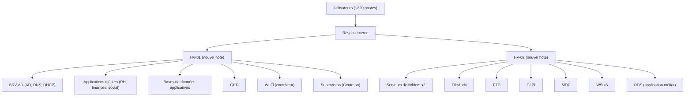
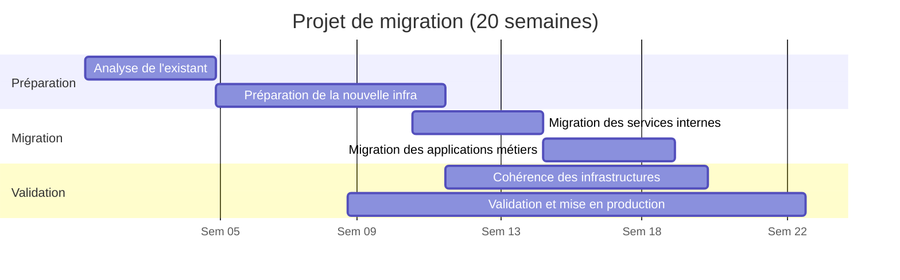

# Migration d'une infrastructure serveur de production : Windows Server 2012 vers 2022 (Hyper-V)

> Projet réalisé en tant qu'administrateur systèmes et réseaux dans une organisation publique locale (environ 220 postes, plusieurs sites).
> Document anonymisé : les noms d'organisation, de domaine, de serveurs, de sites, de prestataires et les adresses IP sont des valeurs génériques.

## Résumé

| | |
|---|---|
| **Contexte** | Parc de ~220 postes, service informatique de 4 personnes |
| **Problème** | Hôtes et ~15 VM sous Windows Server 2012 (fin de support), matériel ancien, serveurs applicatifs jamais réinstallés |
| **Solution** | 2 nouveaux serveurs physiques HPE ProLiant Gen11, Hyper-V, VM sous Windows Server 2022, migration progressive avec coexistence |
| **Durée** | ~5 mois (20 semaines) |
| **Mon rôle** | Préparation de l'infra, virtualisation, migration AD/DHCP/fichiers/FTP, coordination des prestataires, tests |
| **Résultat** | Migration complète sans interruption notable, supervision (Centreon), audit des accès fichiers (FileAudit), sauvegarde Acronis + NAS + copie hors site |

**Compétences démontrées** : Windows Server, Active Directory (réplication, FSMO), DHCP, Hyper-V, PowerShell, stockage RAID, migration à IP conservée, gestion de projet et de prestataires, supervision, sauvegarde, durcissement (moindre privilège, GPO, pare-feu).

---

## 1. Situation initiale et problèmes

- 2 serveurs physiques sous Windows Server 2012 hébergeant ~15 VM : contrôleurs de domaine (AD, DNS, DHCP), serveurs de fichiers, serveurs applicatifs, applications métiers.
- Windows Server 2012 en fin de support : plus de correctifs de sécurité.
- Matériel ancien, limites de performance et d'évolutivité.
- Serveurs maintenus par mises à jour successives, jamais réinstallés : configurations héritées.
- Éditeurs métiers dont les prérequis évoluent (OS plus récents exigés).
- Réseau limitant les performances : renouvellement des commutateurs et liaisons fibre inter-bâtiments menés en parallèle avec un prestataire.

## 2. Contraintes

- **Continuité de service** : usage quotidien par les agents, interruptions à limiter.
- **Compatibilité applicative** : prérequis spécifiques des éditeurs, à valider avant chaque migration.
- **Coexistence** ancien / nouveau environnement pendant la transition.
- **Prestataires externes** : disponibilité, créneaux, décalage horaire avec certains intervenants.
- **Ressources** : 4 personnes, projet à mener en parallèle du support quotidien.

## 3. Choix de la solution

| Option | Avantages | Inconvénients |
|---|---|---|
| Mise à jour de l'existant | Simple, coût réduit | Matériel ancien conservé, performances limitées, évolution difficile |
| Migration vers le cloud | Maintenance simplifiée, externalisation | Dépendance à la connexion internet, risque lié à la connectivité du territoire (liens sous-marins, intempéries) |
| **Renouvellement de l'infra locale (retenu)** | Maîtrise, performances, services disponibles localement | Investissement matériel, maintenance à la charge du service |

**Décision** : renouveler l'infrastructure locale en gardant une architecture virtualisée. Le critère déterminant était la continuité de service face à une connectivité WAN contrainte.

## 4. Architecture cible



### Matériel

| Élément | Caractéristique |
|---|---|
| Serveurs physiques | 2 x HPE ProLiant Gen11 |
| Processeurs | 2 x 64 cœurs par serveur |
| Mémoire | 256 Go par serveur |
| Réseau | 2 cartes par serveur, vSwitch externe sur interface 10 Gb |
| Stockage | 5 SSD de 1 To par hôte, **RAID 5 matériel** |
| Alimentation | Redondée sur onduleur |
| Répartition | ~10 VM par hôte |

### Logiciels

| Catégorie | Outil |
|---|---|
| OS | Windows Server 2022 |
| Virtualisation | Hyper-V |
| Annuaire / réseau | Active Directory, DNS, DHCP |
| Parc / ticketing | GLPI |
| Déploiement postes | MDT |
| Mises à jour | WSUS |
| Supervision | Centreon |
| Audit fichiers | FileAudit |
| Sauvegarde | Acronis Cyber Protect |
| Copie de données | Robocopy |

## 5. Planning



*(Dates fictives : seule la durée relative des phases est représentative.)*

## 6. Mise en œuvre

### 6.1 Installation physique

1. Installation d'une baie réseau, centralisation des équipements.
2. Montage des 2 serveurs, alimentation redondée sur onduleur, raccordement réseau.
3. Premier démarrage : contrôle BIOS/UEFI (CPU, RAM, stockage, interfaces).
4. Configuration du RAID 5 matériel (tolérance à la panne d'un disque), installation de Windows Server, partitionnement : volume système + volume dédié Hyper-V.

### 6.2 Virtualisation

- Rôle Hyper-V installé sur chaque hôte.
- Commutateur virtuel externe lié à l'interface 10 Gb.
- Volume dédié : `D:\HYPER-V\CONFIG` (configuration des VM) et `D:\HYPER-V\VHDX` (disques virtuels).
- **Création des VM par script PowerShell**, pour standardiser et limiter les erreurs.

```powershell
# Création en série des VM d'un hôte (noms génériques)
$VMPath      = "D:\HYPER-V\CONFIG"
$VHDPath     = "D:\HYPER-V\VHDX"
$SwitchName  = "VSWITCH-10G"

$VMs = @(
    @{Name="SRV-MONITORING"; RAM=4GB;  CPU=3; VHDSize=60GB},
    @{Name="SRV-AD";         RAM=4GB;  CPU=4; VHDSize=80GB},
    @{Name="SRV-APP-1";      RAM=8GB;  CPU=4; VHDSize=120GB},
    @{Name="SRV-APP-2-DB";   RAM=16GB; CPU=4; VHDSize=200GB},
    @{Name="SRV-GED";        RAM=12GB; CPU=4; VHDSize=200GB}
)

foreach ($vm in $VMs) {
    $VHDFile = Join-Path $VHDPath "$($vm.Name).vhdx"

    Write-Host "Création du disque pour $($vm.Name)"
    New-VHD -Path $VHDFile -SizeBytes $vm.VHDSize -Dynamic

    Write-Host "Création de la VM $($vm.Name)"
    New-VM -Name $vm.Name `
           -MemoryStartupBytes $vm.RAM `
           -Generation 2 `
           -VHDPath $VHDFile `
           -Path $VMPath `
           -SwitchName $SwitchName

    Set-VMProcessor -VMName $vm.Name -Count $vm.CPU
    Write-Host "VM $($vm.Name) créée avec succès"
}
```

> Remarque : disques en allocation dynamique, choix pratique mais à surveiller côté espace disque réel (voir [Axes d'amélioration](#9-axes-damélioration)).

### 6.3 Migration des services d'infrastructure

Principe : un service à la fois, hors heures de bureau, vérification avant de passer au suivant, sur plusieurs jours.

#### Active Directory et DHCP (même serveur à l'origine)

1. Nouvelle VM Windows Server 2022, IP fixe, DNS pointant vers le contrôleur existant.
2. Jonction au domaine, promotion en **contrôleur de domaine supplémentaire**.
3. Coexistence : vérification de la réplication, tests d'authentification, de résolution DNS et d'application des GPO.
4. Transfert des 5 rôles FSMO une fois le nouveau DC validé :

```powershell
netdom query fsmo
Move-ADDirectoryServerOperationMasterRole -Identity "SRV-AD" -OperationMasterRole 0,1,2,3,4
```

5. DHCP : installation du rôle sur le nouveau serveur, export/import de la configuration :

```bat
netsh dhcp server export C:\dhcp.txt all
netsh dhcp server import C:\dhcp.txt all
```

6. Rétrogradation et retrait progressif de l'ancien serveur après validation.

Résultat : domaine, utilisateurs, groupes et GPO conservés ; une quinzaine d'étendues DHCP (une par site) migrées.

#### Serveurs de fichiers et FTP

1. Nouvelle VM avec **IP temporaire** différente de l'ancien serveur.
2. Copie des données avec **Robocopy** en conservant structure et droits NTFS.
3. Validation des partages (accès, droits, réseau).
4. **Réattribution de l'IP d'origine** à la nouvelle VM : aucune modification des GPO, scripts de connexion ni chemins réseau, donc aucune action sur les postes clients.
5. Mise hors service progressive de l'ancien serveur.

### 6.4 Applications métiers et prestataires

- VM préparées en amont (prérequis, réseau, ressources).
- Même méthode que pour les fichiers : IP temporaire, installation par le prestataire, validation, puis bascule de l'IP d'origine.
- Vérifications techniques par l'équipe : connexion aux bases, services applicatifs, communication inter-serveurs, accès utilisateurs.
- Tests fonctionnels par des utilisateurs métiers dans des conditions réelles.
- Contraintes gérées : certaines interventions en heures de bureau (prestataires indisponibles en dehors), décalage horaire de 2 à 3 heures avec certains prestataires, planification des créneaux.

### 6.5 Plan de tests

| Service | Test | Objectif |
|---|---|---|
| Active Directory | Connexion d'un poste | Vérifier l'authentification |
| Active Directory | Vérification de la réplication | Assurer la synchronisation |
| DHCP | Attribution d'IP sur tous les sites | Vérifier le service |
| Serveurs de fichiers | Accès aux partages | Droits et disponibilité |
| FTP | Transfert, numérisation | Fonctionnement |
| Applications métiers | Connexion et usage | Accès et fonctionnement |
| Réseau | Communication entre équipements | Connectivité |

## 7. Sécurisation

| Mesure | Détail |
|---|---|
| Système maintenu | Windows Server 2022, correctifs automatiques (WSUS) |
| Moindre privilège | Droits strictement nécessaires par fonction, groupes de sécurité rationalisés |
| Comptes à privilèges | Droits administrateur **révoqués** pour les comptes non techniques (dont la direction) |
| GPO | Vérifiées et ajustées : mots de passe, accès aux ressources sensibles, configuration système |
| Pare-feu | Pare-feu Windows actif sur tous les serveurs, flux limités au nécessaire |
| Supervision | Centreon : état des serveurs, services, ressources |
| Traçabilité | FileAudit : consultation, modification, suppression sur les partages |

## 8. Sauvegarde et continuité

**Architecture** : serveur de gestion Acronis, 2 NAS en RAID 5 (un dans le local réseau du bâtiment principal, un en salle serveurs), copie externalisée hors site par un prestataire.

| Paramètre | Valeur |
|---|---|
| Périmètre | Machine entière (VM) |
| Planification | Lundi à vendredi, 22:00 : complète hebdomadaire + incrémentale quotidienne |
| Rétention | Hebdomadaire : 2 semaines ; quotidienne : 14 jours |
| Destinations | NAS local + copie hors site |

**Continuité** : aucun PRA/PCA n’existait avant le projet. Un PRA a été mis en place en réutilisant les anciens serveurs comme site de secours : en cas d’indisponibilité de la nouvelle infrastructure, les services et VM critiques repartent en mode dégradé (RPO max 2 h, RTO 12 h).

## 9. Au-delà de la migration : sauvegarde, continuité et sécurisation

Analyse critique du projet et pistes que je traiterais ensuite :

- **Tests de restauration** : réalisés à plusieurs reprises pendant la migration. Une sauvegarde non testée n’est pas une sauvegarde.
- **Règle 3-2-1** : appliquée (3 copies, 2 supports, 1 copie hors site). Le RAID protège d’une panne de disque, il ne remplace pas une sauvegarde.
- **Rétention** : 31 jours d’historique.
- **PRA** : mis en place sur les anciens serveurs réutilisés en site de secours, avec reprise des services critiques en mode dégradé (RPO max 2 h, RTO 12 h), scénarios de reprise et procédure de bascule définis.


## 10. Bilan

Les migrations prévues ont été réalisées avec une infrastructure plus performante, supportée et mieux surveillée. L'approche progressive (coexistence, validation à chaque étape, réutilisation de l'IP d'origine) a évité toute reconfiguration des postes clients et limité l'impact sur les utilisateurs.

**Ce que j'en retiens** : planifier avec les prestataires dès le début, valider chaque étape avant la suivante, documenter au fil de l'eau, et traiter la sauvegarde et le PRA comme des livrables à part entière.
